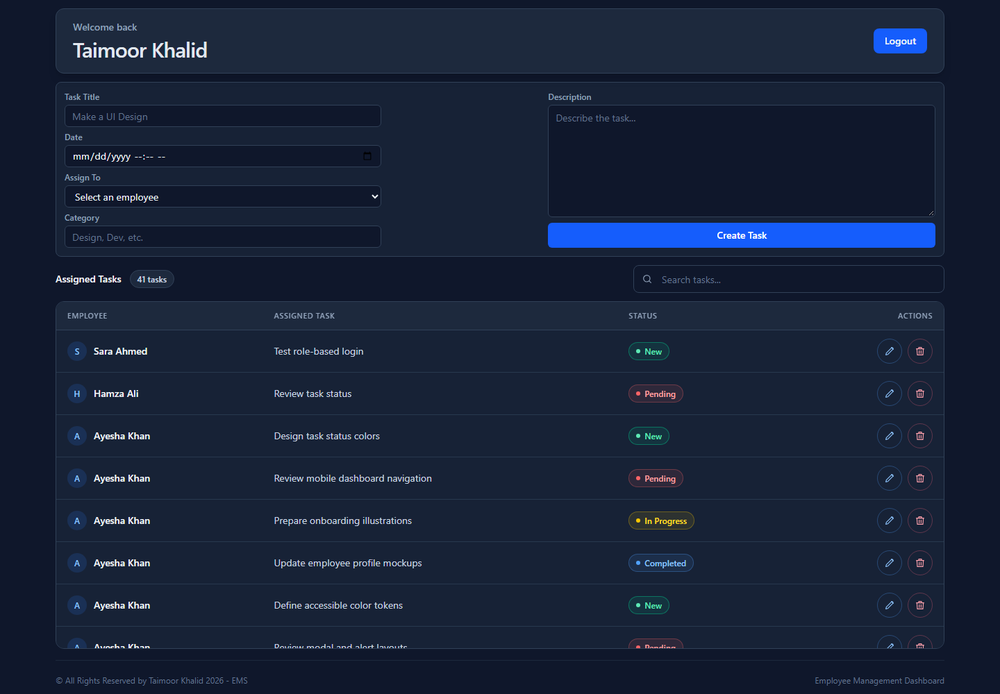
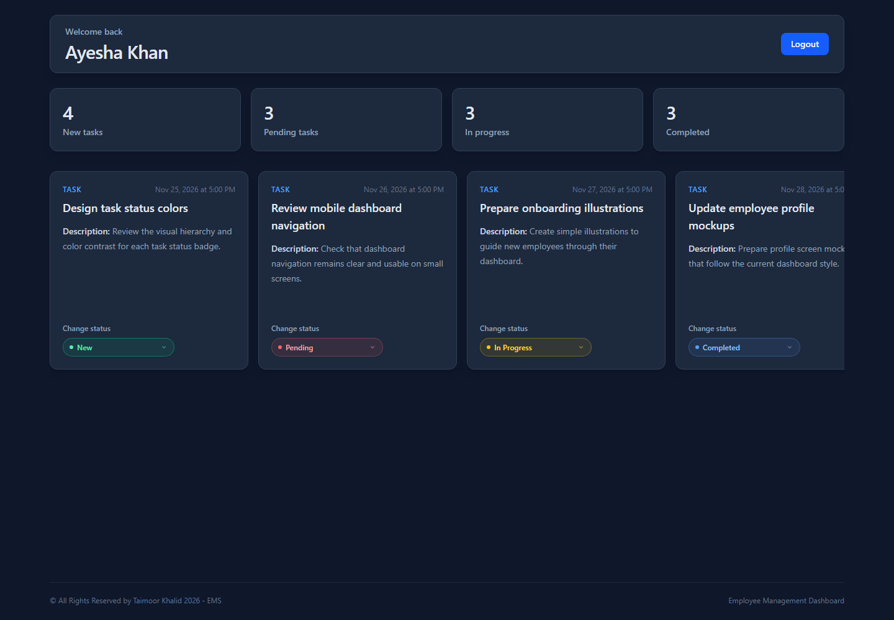

# Employee Management System

A responsive employee and task management dashboard built with React. Admins can manage assigned work, while employees can review their tasks and update progress.

## Dashboards

| Admin dashboard | Employee dashboard |
|:--:|:--:|
|  |  |

## Features

- Role-based admin and employee dashboards
- Admin task creation, editing, deletion, and fuzzy search
- Employee task summaries and status updates
- JSON Server mock API with localStorage data and session caching
- Responsive layout with task status indicators

## Tech stack

- React 19 and JavaScript
- Tailwind CSS 4 and Vite 8
- JSON Server for the mock REST API
- Fuse.js for fuzzy task search
- Browser localStorage for cached app data and login state

## Run locally

Requires Node.js and npm.

```sh
npm install
```

Run the API and frontend in separate terminals:

```sh
npm run server
```

```sh
npm run dev
```

The frontend runs at the URL printed by Vite. The JSON Server API runs at `http://localhost:3001`.

## Demo accounts

| Role | Email | Password |
|:--|:--|:--|
| Admin | `taimoor@example.test` | `12345` |
| Employee | `ayesha@example.test` | `123` |

## Checks

```sh
npm run lint
npm run build
```

## Note

This is a learning project. The demo credentials and client-side authentication are not suitable for production or real employee data.
